<picture>
  <source media="(prefers-color-scheme: dark)" srcset="assets/header-dark.svg">
  
</picture>

**I build internal tools and workflow systems with clear evidence, human review, and practical decision support.**

A Copenhagen-based DTU MSc Engineering graduate in Mathematical Modelling and Computation, building practical systems for complex operational work. My strongest work sits around internal tools, workflow automation with human review, data-quality workflows, and decision-support systems.

On the side I design and ship small Apple apps, alone, end to end.

&nbsp;[me.isjia.page](https://me.isjia.page) &nbsp;&nbsp; &nbsp;[app.isjia.page](https://app.isjia.page) 
&nbsp;Copenhagen &nbsp;&nbsp; &nbsp;English · 中文

### <picture><source media="(prefers-color-scheme: dark)" srcset="assets/heading-work-dark.svg"></picture>

**[OpsDesk](https://jobops.zhangjiajia.me/opsdesk)** ↗ &nbsp;DEMO 
A support/operations demo that turns cases into evidence, draft actions, approvals, feedback memory, and replayable logs.

**[Denmark Flex Planner](https://flex.zhangjiajia.me)** ↗ &nbsp;LIVE 
A map-first decision-support tool for prioritizing Danish EV charging and local flexibility investments under budget, grid-zone, and regional constraints.

**[Afgang](https://me.isjia.page/en/projects/afgang)** &nbsp;CASE STUDY 
A local-first Copenhagen transport utility combining commute decisions with conservative, timetable-based reachability maps.

**[ASCII Studio](https://ascii.isjia.page)** ↗ &nbsp;LIVE · [SOURCE](https://github.com/isjiajia01/ascii-studio) 
Turns any image or video into ASCII, braille, halftone, dither or brick textures, rendered live in the browser and exported without uploading anything.

**[DTU × Mover Thesis](https://github.com/isjiajia01/dtu-thesis-workspace)** &nbsp;THESIS 
A real logistics planning project: decide how multi-day deliveries should be admitted, routed, and recovered when depots are under stress.

**[Apple apps](https://app.isjia.page)** ↗ &nbsp;APP STORE 
Eight small Apple apps designed and built solo, five live on the App Store for iPhone, Watch, TV, Mac and Safari. Local-first, no accounts, ads or tracking.

### <picture><source media="(prefers-color-scheme: dark)" srcset="assets/heading-more-dark.svg"></picture>

- [job-ops](https://github.com/isjiajia01/job-ops): self-hosted job-search pipeline for the Danish/EU market, with LLM fit scoring, resume tailoring and application tracking
- [Nu](https://github.com/isjiajia01/Nu): native iOS transit app for Copenhagen, with departure boards, a journey planner and live vehicle tracking
- [jobradar-relate](https://github.com/isjiajia01/jobradar-relate): explainable job recommendations on a knowledge graph (Relate by Neo4j hackathon)
- [painterly-sky](https://github.com/isjiajia01/painterly-sky): procedural painted-gradient backgrounds in WebGL2, zero dependencies
- [canopy-dotmatrix](https://github.com/isjiajia01/canopy-dotmatrix): reverse-engineered decoder for a 6-bit temporal-delta dot-matrix video format
- [personal-website](https://github.com/isjiajia01/personal-website): the source of me.isjia.page

### <picture><source media="(prefers-color-scheme: dark)" srcset="assets/heading-toolbox-dark.svg"></picture>

MODELLING &nbsp; optimization · vehicle routing · rolling-horizon planning · decision support 
LANGUAGES &nbsp; Python · Julia · TypeScript · Swift 
BUILDING &nbsp; SwiftUI · Next.js · FastAPI · WebGL2 · Docker · Oracle Cloud

### <picture><source media="(prefers-color-scheme: dark)" srcset="assets/heading-contributions-dark.svg"></picture>

<picture>
  <source media="(prefers-color-scheme: dark)" srcset="https://raw.githubusercontent.com/isjiajia01/isjiajia01/output/snake-dark.svg">
  
</picture>

 

