### Hi, I'm Jiajia 👋

Operations research, optimization, and decision-support systems. I take complex operational problems, structure them into tractable models, and build software so teams can act on the results.

MSc Mathematical Modelling & Computation · DTU Copenhagen · [zhangjiajia.me](https://zhangjiajia.me)

---

**Things I've built:**

- [dtu-thesis-workspace](https://github.com/isjiajia01/dtu-thesis-workspace) — rolling-horizon last-mile delivery optimization; manuscript, controller, and solver in one workspace
- [job-ops](https://github.com/isjiajia01/job-ops) — self-hosted job search pipeline: LLM fit scoring, resume tailoring, cover letters, application tracking
- [Nu](https://github.com/isjiajia01/Nu) — native iOS transit app for Copenhagen; departures, journey planner, live vehicle tracking
- [personal-website](https://github.com/isjiajia01/personal-website) — bilingual portfolio built with Next.js, deployed to OCI

---

**Contributions (past year)**

